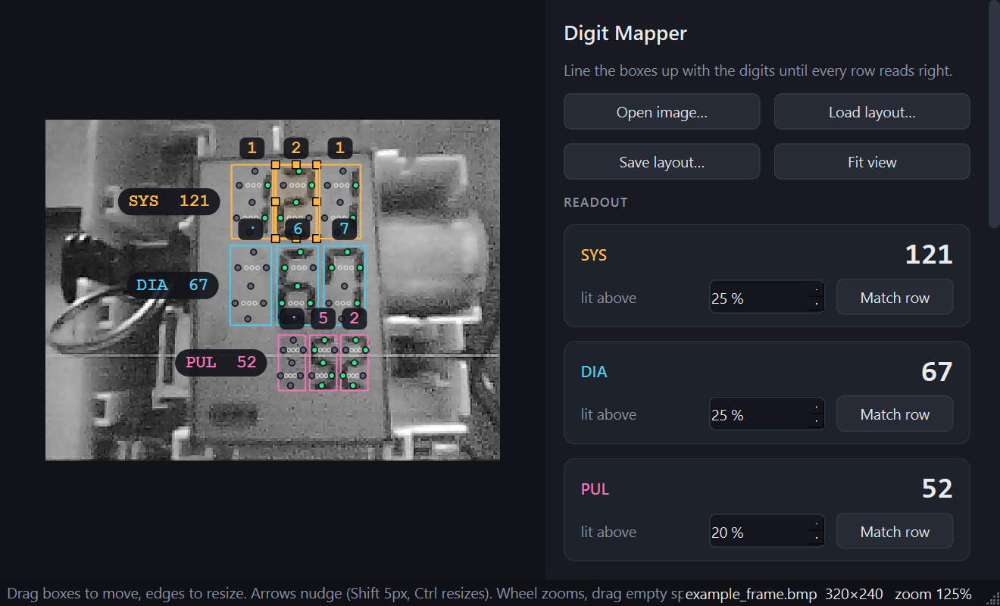

# Smart Blood Pressure Monitor (DIY)

Turn an ordinary blood pressure monitor into a connected one by pointing an
ESP32-CAM at its display. The camera reads the seven-segment digits (SYS, DIA,
PULSE) and sends each new result over WiFi to wherever you want: Home
Assistant, Node-RED, or your own server.

No wires into the monitor are needed. The monitor does the measuring, and this
project only reads the numbers off its screen.

**▶ Watch the build video: https://youtu.be/RaaQwIr86ZE**



## What you need

- AI-Thinker ESP32-CAM, plus a USB-serial adapter or ESP32-CAM-MB board to program it
- A blood pressure monitor with a seven-segment LCD (built on the A&D UA-611)
- A way to hold the camera still in front of the display. The 3D-printable
  camera arm from the video is in [`cad/Bpm_Cam_Arm.step`](cad/Bpm_Cam_Arm.step).
  It's designed around the A&D UA-611, so other monitors will need it adapted.
- Arduino IDE 2 with the **esp32** boards package 3.x
- Python 3.9+ for the digit mapper

In the Arduino IDE, use board **AI Thinker ESP32-CAM** with PSRAM enabled. To
upload over WiFi later, also pick the partition scheme **Minimal SPIFFS (1.9MB APP with OTA)**.

## The workflow

```
1_camera_preview  ->  2_digit_mapper  ->  3_reader
 live view, save       drag boxes onto      reads the display and
 one frame             the digits           sends each result
```

### Step 1: Camera preview

1. Copy `1_camera_preview/camera_preview/secrets.example.h` to `secrets.h` in the same folder and fill in your WiFi.
2. Open `1_camera_preview/camera_preview/camera_preview.ino` and upload it.
3. Open the Serial Monitor (115200). Go to the address it prints, or http://bp-camera.local.
4. Fix the camera in place so the display fills as much of the picture as you can, square-on and in focus.
5. Take a measurement. While the result is on screen, click **Save frame**. You now have `frame.bmp`.

Don't move the camera after this. The digit positions only hold for this exact spot.

### Step 2: Digit mapper

```
cd 2_digit_mapper
pip install -r requirements.txt
python digit_mapper.py
```

1. Drop `frame.bmp` onto the window.
2. If the picture is upside down, tick **Rotate 180°**.
3. Drag each box over its digit so it covers the whole "8" shape, including
   the blank hundreds position. **Match row** lines a row up evenly.
4. Every row should read the number on your display. Green dots mean lit
   segments, grey means unlit, and orange means too close to call. Adjust the
   "lit above" % per row until nothing is orange.
5. Click **Write into bp_reader.ino**, or copy the code and paste it over the
   `DIGIT MAP` block in the sketch yourself.

You can try it straight away on `docs/example_frame.png`.

### Step 3: Reader

1. Copy `3_reader/bp_reader/secrets.example.h` to `secrets.h` and fill in your WiFi and
   `SEND_URL`, the address readings are sent to.
2. Open `3_reader/bp_reader/bp_reader.ino` and work through settings 1 to 5 at the top:
   1. **WiFi**: done in `secrets.h`.
   2. **Where readings go**: `SEND_URL`, plus `SEND_AUTH` if your server needs a token.
   3. **Who is measuring**: names, and optional buttons to tell people apart.
   4. **Sleep**: leave `WAKE_PIN` at -1 to keep the board always on.
   5. **Digit map**: filled in by step 2.
3. Upload, take a measurement, and watch the Serial Monitor:
   ```
   READING sys=121 dia=67 pul=52
   Send: Me 121/67/52 -> HTTP 200
   ```

The board's own page (http://bp-reader.local) shows what the camera sees with
the boxes drawn on. `/debug` shows segment-by-segment detail if a digit
misreads.

## Where readings go

Each result is sent as an HTTP POST with a JSON body:

```json
{"user": "Me", "systolic": 121, "diastolic": 67, "pulse": 52}
```

- **Home Assistant**: create an automation with a *Webhook* trigger and set
  `SEND_URL` to `http://<home-assistant>:8123/api/webhook/<your-id>`. The
  values are in `trigger.json`.
- **Node-RED**: an `http in` node (POST).
- **Anything else**: change `sendReading()` in `bp_reader.ino`. It's the only
  function that knows where readings go.

If sending fails, the reading is queued and sent with the next one.

## Optional extras

- **Two people**: wire a button from GPIO 13 to GND (A) and one from GPIO 15
  to GND (B), then set `BTN_A = 13` and `BTN_B = 15`. Press yours during the
  measurement. The LED on the back blinks once for A and twice for B.
- **Battery / deep sleep**: wire GPIO 14 to the monitor's START button line
  and set `WAKE_PIN = 14`. The board sleeps until START is pressed, sends the
  result, then sleeps again. Hold A and B together for 2 seconds to bring up
  the web page and OTA. This one does need a wire into the monitor, so only
  try it if you're comfortable opening it up.

Leave the SD card slot empty: GPIO 13, 14 and 15 are its pins.

## Notes from the original build

The [video](https://youtu.be/RaaQwIr86ZE) covers the full story. The short version:

- **Why a camera?** The monitor's main chip also drives the display, so the
  finished reading never appears on a bus you can sniff. Working out blood
  pressure from the raw pressure sensor got diastolic and pulse close, but
  systolic was still 8 to 9 points off. Reading the screen gives exactly what
  the monitor shows.
- **Camera position:** mount it square-on to the display. An angled view made
  the bottom row hard to read reliably. Once it's in the right spot, a few
  dots of super glue stop it shifting when the monitor is picked up.
- **Reflections:** the clear window in the monitor's front sticker caused
  glare. Cutting that part of the sticker away fixed it.
- **Power and wake:** in the original build, the ESP32-CAM runs from the
  monitor's 6 V battery feed into its 5 V pin, which works but is outside spec.
  The START button pulls a 3.3 V line to ground, which wakes the board from
  deep sleep. That's three wires in total: +, − and START.

## Troubleshooting

| Problem | Try |
| --- | --- |
| `Camera init failed` | Reseat the ribbon cable and check PSRAM is enabled. |
| Digits read as `?` | Open `/debug`. Nudge the boxes in the mapper, or change that row's "lit above" %. |
| Works in the mapper but not on the board | The camera moved, or the light changed a lot. Save a new frame from the board's page and map again. |
| Glare on the LCD | Angle the camera slightly instead of square-on, and keep the flash off. |
| `HTTP -1` when sending | `SEND_URL` can't be reached from the ESP32. Try the IP address instead of a hostname. |

## Disclaimer

This is a hobby project, not a medical device. It copies numbers off a screen
and can misread them. Check anything important against the monitor itself.
